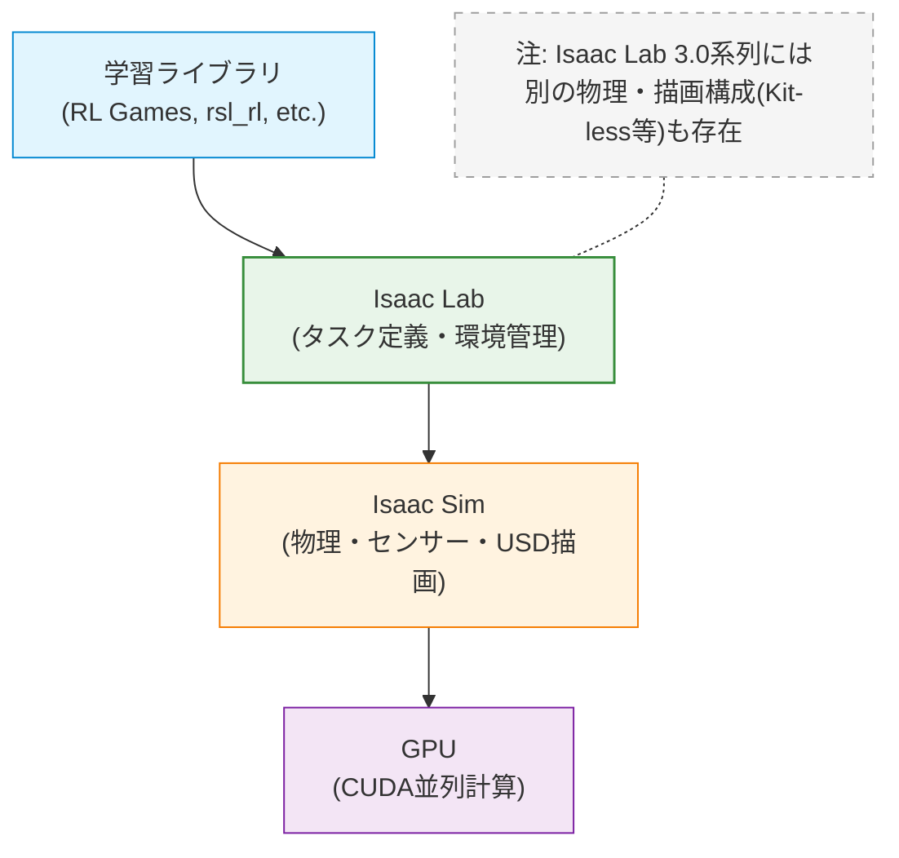
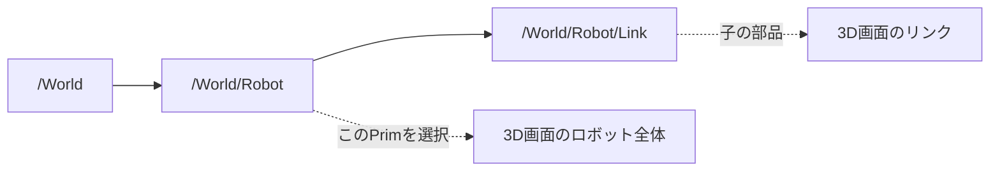
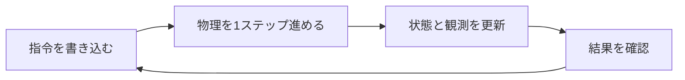
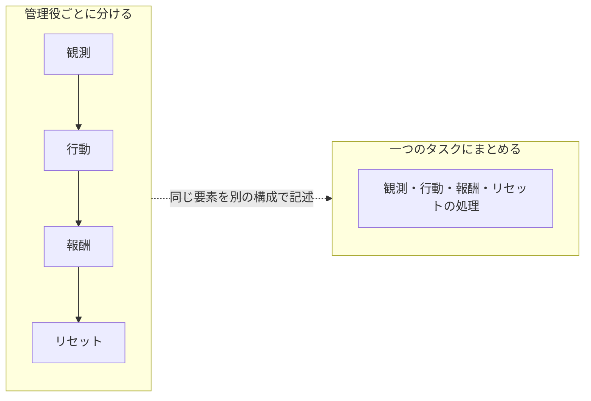

## 第3章 NVIDIA Isaac Labとは

### 3.1 Isaac SimとIsaac Labの役割

**Isaac Lab**は、**NVIDIA Isaac Sim**をベースに構築された、ロボット学習および強化学習のためのモジュール型軽量フレームワークです。ロボットのポリシーの訓練、強化学習環境の構築、データの収集などを効率的かつスケーラブルに行うための仕組みを提供します。

特に、**Isaac Lab**のモジュール化されたアーキテクチャとGPUによる超並列化処理は、ヒューマノイドロボット、自律走行搬送ロボット（AMR）、ロボットアーム（マニピュレータ）など、多様な形態（Embodiments）のロボットに対応する学習モデルを構築する上で最適な環境を提供します。

一方で、それらの土台となるのが、NVIDIAが提供するリアルタイム3Dシミュレーションおよびコラボレーションプラットフォームである **NVIDIA Omniverse** です。Omniverseは、OpenUSDを共通言語とし、リアルタイムの高度なレンダリングや物理計算、複数ツール間のデータ統合を実現する基盤エコシステムです。

そのOmniverseプラットフォーム上で動作するアプリケーションの一つが **Isaac Sim** であり、高度な3Dシーン、リアルタイムの物理計算、センサーシミュレーション、外部システムとの接続などを総合的に扱います。Isaac Labは、そうした **Isaac Sim** の強力なシミュレーション機能を、ロボット学習の実験パイプラインへと体系的に組み込む役割を果たします。

したがって、「Isaac Labなら必ずIsaac Simの画面が開く」という理解では、現在の構成を説明しきれません。学習の計算、物理計算、センサー用の画像生成、人が確認する画面を分けて考えます。

**図3-1 本書で使う構成（概念図）**



本書の画面付き手順はIsaac Simを使う構成を対象とする。

### 3.2 バックエンドという言葉と役割の分離

「バックエンド」という言葉は、少し難しく感じるかもしれません。

簡単に言えば、**「ユーザーが見える共通の操作画面やAPIの裏側で、実際に泥臭い計算処理を担当しているエンジン（実装）」** のことです。

Isaac Lab 3.0では、このバックエンドがさらに進化し、実行目的に応じて「物理計算」や「画面描画」の実装を柔軟に切り替えられる仕組み（マルチバックエンド構造）が採用されています。

---

#### シミュレーションの3つの役割

Isaac Labを使う上での大きなコツは、シミュレーション処理を以下の**3つの役割**に分けて理解することです。

* **① 物理計算エンジン**
  * ロボットや物体の動き、重力、衝突判定、関節のトルクなどを計算する役割です（例: PhysX や Newton など）。

* **② レンダラー**
  * カメラセンサー用の画像データや深度情報（Depth）を生成する役割です。画面の表示・非表示に関わらず、カメラ画像を使うタスクでは裏でこの処理が働きます。
 
* **③ ビジュアライザー**
  * 開発者がシミュレーションの様子をディスプレイ上で直感的に確認するための「画面表示（GUI）」を担当する役割です。

これら3つは独立した機能です。例えば、人間が見るための画面表示（ビジュアライザー）をオフ（Headlessモード）にしても、ロボットがカメラ画像をもとに学習を行う場合は、内部でレンダラーが動作し続けています。

---

#### コマンドライン引数での指定例

Isaac Labのタスクを実行する際、コマンドラインからバックエンドや表示モードを指定することがあります。

```bash
# コマンド実行のイメージ
python train.py --task Isaac-Cartpole-v0 physics=isaacsim_physx --viz kit
```

### 3.3 USDで場面を記述する

USDは **Universal Scene Description** の略で、ピクサー・アニメーション・スタジオが開発した、3Dシーンを記述し複数のデータセットを統合するためのメカニズムです。「OpenUSD」とも呼ばれています。

ロボットの形状だけでなく、位置、材質、階層構造も管理できます。Isaac Simから物理情報を追加することで、質量、衝突判定、関節などのパラメータを設定できます。ただし、USDファイルが存在するからといって、必ずしも正しい物理ロボットモデルが生成されるとは限りません。[公式のアセット導入説明](https://isaac-sim.github.io/IsaacLab/v3.0.0-EA/source/how-to/import_new_asset.html)

開かれた場面全体は「Stage」と呼ばれます。Stageの中の各要素は「Prim」と呼ばれ、`/World/Robot`のようなパスで識別できます。パスは場面の中の住所です。ファイルの保存場所とは別のものです。

```text
/World
├── Ground
├── Light
└── Robot
    ├── Base
    └── Arm
```

これは説明用の階層です。実際のロボットの名前や構造はアセットごとに異なります。

**図3-2 Primのパスと3Dの対応（概念図）**



Primのパスは場面内の住所であり、Stageの階層と3D画面の物体を結び付ける。

**未撮影の写真：写真3-1。

**内容**： ロボットのサンプルでStageパネルを開き、モデルの親Primを選択している状態。選択中のパス、階層、3D画面での選択状態を一枚に収める。

**撮影時の留意事項**: ①対象のOSとIsaac Sim／Isaac Labのバージョン、②実行したコマンドまたは画面操作、③画面で読める成功・失敗の根拠をあわせて記録する。※画面上の実際の名前と本文の例が異なる場合は、キャプションを実画面に合わせる。

### 3.4 計算グラフと実行フロー

計算グラフは、処理を箱、データや実行のつながりを線で表したものです。「時刻を受け取る→センサー値を読む→外部へ送る」と描くと、処理の順番を追いやすくなります。

Isaac Simでは、**OmniGraph** を使って処理をノードで視覚的に組み立てる方法があります。

> **OmniGraphとは：**
> OmniGraphは、Omniverseにおけるビジュアルスクリプト言語です。これによって、Omniverse内の世界に動作やインタラクティブ性を持たせることができます。変形処理やパーティクルからイベント駆動型グラフまで、あらゆる種類の計算に対応しており、単一のフレームワークの下に多くの異なるグラフシステムが統合されています。
> 
> 主に以下の2種類のグラフを作成できます。
> * **Action Graphs（アクション・グラフ）：** イベント駆動型の動作を記述します。
> * **Push Graphs（プッシュ・グラフ）：** ノードを継続的に評価・実行します。
> 
> さらに、パーティクルシステムやスケルタルアニメーションなどのノードライブラリも提供されています。
> （参考：[OmniGraphチュートリアル](https://docs.omniverse.nvidia.com/extensions/latest/ext_omnigraph.html)）

しかし、Isaac Labの学習処理を理解するために、最初からOmniGraphの画面でタスク全体を作る必要はありません。

本書ではPythonの実行フローを先に見ます。起動後に場面を作り、初期化し、繰り返しの中で指令を書き込み、物理計算を進め、更新後の状態を読む。この順番を理解すると、公式コードが読みやすくなります。

**図3-3 シミュレーションの実行順序（概念図）**



これは実行順序の説明図であり、OmniGraphの実画面ではない。

### 3.5 Manager-based環境 と Direct環境

Isaac Labで強化学習タスクを構築する際、主に **Manager-based** 方式と **Direct** 方式の2つの設計アプローチ（ワークフロー）が用意されています。

これらを理解する上で鍵になるのが **「クラス（Class）」** というPythonの仕組みです。Pythonにおけるクラスとは、**「関連するデータ（変数）と処理（関数）を一つの箱にまとめて整理するための設計図」** のようなものです。ロボットの環境構築においては、「シミュレーション環境全体をどう初期化し、どうステップを進めるか」の定義をクラス単位で行います。

* **Manager-based 方式:**  
  観測（Observations）、行動（Actions）、報酬（Rewards）、終了条件（Terminations）などの役割ごとに「マネージャー（管理役）」として処理を細かく分割・管理する設計です。報酬項目の入れ替えや組み合わせの比較検討が容易になり、大規模なタスクでも構造をきれいに保つことができます。

* **Direct 方式:**  
  1つの環境クラスの中に、シミュレーションの計算ロジックや処理の流れを直接（ダイレクトに）記述する設計です。処理の全体フローを単一のファイルやクラス内で直感的に追いやすい反面、コードベースが大きくなると自分で管理する範囲が増加します。

（参考：[公式のタスク設計ワークフロー](https://isaac-sim.github.io/IsaacLab/v3.0.0-EA/source/concepts/task_workflows.html))

どちらかが、すべての初心者にとって簡単というわけではありません。最初は読んでいるサンプルと同じ方式を使い、途中で方式を変えずに一つの流れを理解しましょう。

**図3-4 タスクのコードの分け方（概念図）**



観測、行動、報酬、リセットという材料は同じで、コードの置き方が異なる。

### 3.6 チェックポイント

本章で学んだ重要な概念を振り返るために、以下のチェックリストで確認してみましょう。

- [ ] **Isaac LabとIsaac Simの役割：**  
  Isaac Labがロボット学習向けのフレームワークであり、土台となるIsaac Simや柔軟なバックエンド（Kit-less構成など）とどのように連携しているかを説明できる。

- [ ] **バックエンドと役割の分離：**  
  「物理計算エンジン」「レンダラー（センサー用画像生成）」「ビジュアライザー（確認用画面）」の3つの役割の違いを区別し、画面を閉じてもセンサー処理が動き得ることを理解している。

- [ ] **USDとPrimのパス：**  
  ステージ（Stage）上の要素を示すPrimパス（例：`/World/Robot`）が、ファイル保存場所とは異なる「シーン内の住所」であることを理解している。

- [ ] **実行フローと計算グラフ：**  
  OmniGraphの概要（ビジュアルスクリプトの仕組み）を把握し、Pythonコードによるシミュレーションの実行ループ（起動・初期化・ステップ進行）の順序をイメージできる。

- [ ] **Manager-based環境 と Direct環境：**  
  Pythonの「クラス」の基本概念をふまえ、モジュール化されたManager-based方式と、処理を直接記述するDirect方式の違いを理解している。

つまずきポイント：古い資料では`omni.isaac.lab`などの名前が出てくることがあります。本書の`isaaclab`と混ぜず、資料の対象バージョンと移行ガイドを確認してください。

